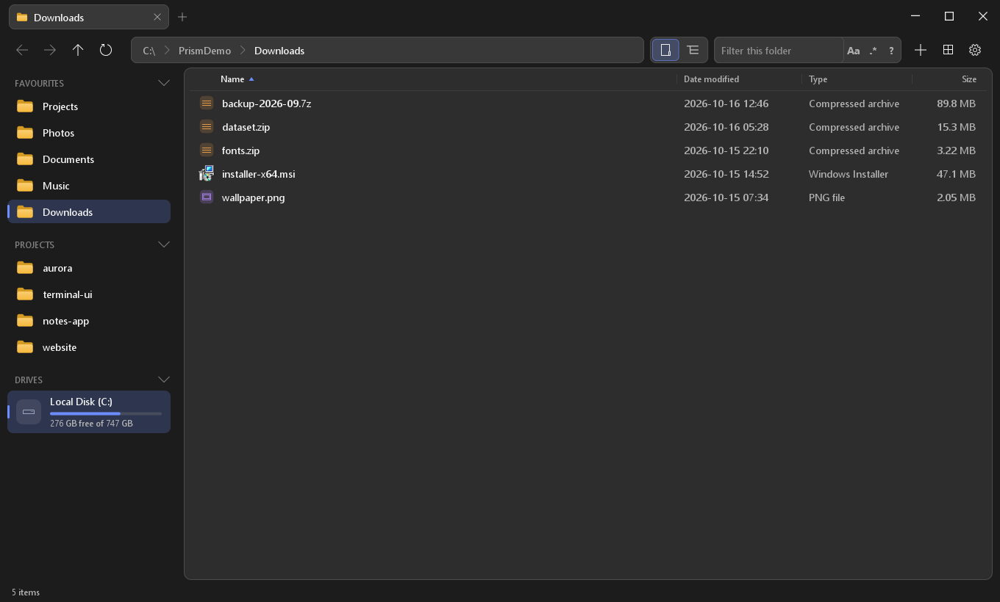
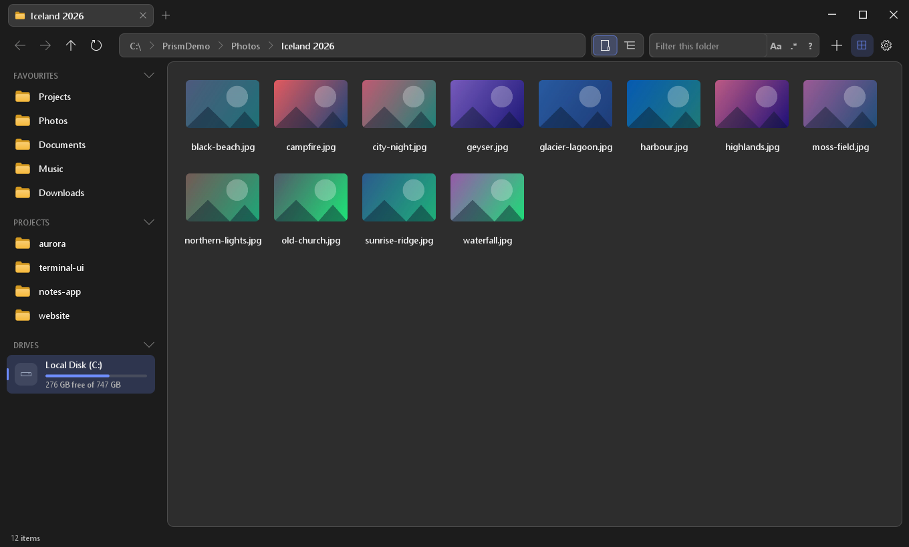

<h1 align="center">PrismFS</h1>
<p align="center">A fast, modern file explorer for Windows 10 / 11.<br>Tabs, two panes, instant search, huge folders without lag.</p>

<p align="center"></p>

## Features

**Browse**
- **Fast** – folders load in the background and only visible rows are drawn: a 200k-file folder opens instantly
- **Tabs, two panes, sessions** – drag tabs (out of the window: into another PrismFS window, or a new one), middle-click closes, `F3` splits; `Ctrl+Shift+O` saves the open tabs under a name
- **Details or thumbnails**, preview pane, **Quick Look** (`Space`), **groups** (right click → Group by name / type / date / size)
- **Sidebar you control** – pinned folders, saved searches, drives with free space, Recent / Frequent
- **Path bar** – click a segment, or its arrow for sibling folders; type a program (`cmd`, `pwsh`, `code .`) and press Enter to run it in this folder; add `admin` (`cmd admin`) to run it elevated
- **Archives open like folders** – Enter on a zip / 7z / tar shows what is inside (a temporary copy)
- **Colour labels** – `Alt+1`…`Alt+8` toggle, `Alt+0` clears; filter with `tag:red`
- **Git badges** – `M` `A` `D` `?` `R` `!` on changed files, branch in the status bar (needs git)

**Search**
- **Filter and subfolder search** – `*.cpp size:>10kb modified:month`, regex, saved searches ([syntax](docs/SEARCH.md))
- **Search everywhere** – `Ctrl+Shift+F` finds names on every fixed drive in a fraction of a second (a low-priority background index built at start)

**Files**
- **Copy / move queue** – progress card (speed, time left, pause, cancel), replace / skip / keep both prompt; Settings can switch back to Windows' copy window
- Delete to Recycle Bin, drag and drop, undo / redo, Windows context menu, **New** menu with your own templates
- **Batch rename** (`F2` on several files), links (symbolic, hard, junction), picture tools (rotate, resize, JPEG / PNG), zip / extract

**Tools**
- **Disk usage** (`Ctrl+Shift+U`) – sortable folder tree beside a treemap, one selection; double click looks insid
- **Folder compare and sync** (`Ctrl+Shift+E`, two panes) – see what differs, pick a direction per row, copy; nothing is deleted
- **Duplicate finder**, **empty-folder cleaner**, folder sizes in the size column (View options)

**Look and feel** – dark / light themes, accent colours, compact density, every shortcut rebindable, command palette (`Ctrl+Shift+P`)

<p align="center"></p>

## Shortcuts

| | |
| --- | --- |
| `Ctrl+T` / `Ctrl+W` / `Ctrl+Tab` | new / close / next tab |
| `Ctrl+Shift+T` · `Ctrl+Shift+D` · `Ctrl+N` | reopen closed tab · duplicate tab · new window |
| `Ctrl+L` · `Alt+←/→/↑` · `Alt+Home` | path bar · back, forward, up · home |
| `Ctrl+F` · `Ctrl+Enter` | filter · search subfolders |''
| `Ctrl+Shift+F` | search everywhere |
| `Ctrl+G` | go to a pinned folder or drive |
| `Space` | Quick Look |
| `Alt+1`…`Alt+8` · `Alt+0` | toggle a colour label · clear labels |
| `Ctrl+Shift+O` · `Ctrl+Shift+E` · `Ctrl+Shift+U` | sessions · compare panes · disk usage |
| `Ctrl+D` · `Ctrl+Shift+S` | pin folder · pin current search |
| `Ctrl+Shift+G` · `Alt+P` · `Ctrl+H` · `Ctrl+Shift+M` | thumbnails · preview pane · hidden files · compact |
| `Tab` · `Ctrl+Alt+C` / `Ctrl+Alt+X` | switch pane · copy / move to the other pane |
| `Ctrl+Shift+N` · `Ctrl+Shift+C` · `Alt+Enter` | new folder · copy path · properties |
| `Ctrl+Alt+T` · `Ctrl+,` | terminal here · settings |
| `Ctrl+Shift+P` | command palette (every action) |
| `F2` · `Shift+F2` · `F3` · `F5` · `F11` | rename · batch rename · two panes · refresh · maximize |

## Run

```
prismfs.exe [folder [second folder]] [--light] [--compact] [--grid] [--preview] [--split] [--settings] [--log]
```

Slow to start, or slow now and then? Turn on *Settings → Diagnostics → Write a log file* (or start with `--log`): `prismfs.log` beside the
settings file lists every start-up step with its time, slow frames and slow folders.

A second folder opens two panes. Flags persist like any setting; `--settings` opens the settings dialog. Settings are in `%APPDATA%\PrismFS\settings.ini`; put a `prismfs.ini` next to the exe for a
portable install (labels, sessions and the sidebar are stored beside it too).

## Build

Needs CMake 4.3+, Visual Studio 2022 (C++ workload and the LLVM / clang-cl component) and a checkout of the
[strata UI framework](https://github.com/root-skaii/strata-ui-framework) next to this folder
(`../DxStrataFramework`, or `-DPRISM_STRATA_DIR=...`).

**Visual Studio Code:** open the folder and press `Ctrl+Shift+B` → *PrismFS: build release*.

**PowerShell:**

```
cmd /c ".\build_vs.cmd release"       # also: debug, dev (no LTO, fast relinks), relwithdebinfo
build\release\bin\prismfs.exe
build\release\bin\prismfs_selftest.exe    # logic tests
```

Architecture notes are in [CLAUDE.md](CLAUDE.md). `tools\make_screenshots.ps1` regenerates the images from a made-up demo folder.

## License

Released under the [MIT License](LICENSE) © 2026 skaii.

## Acknowledgements

Built with the help of Claude (Anthropic), Gemini (Google), using the [strata UI framework](https://github.com/root-skaii/strata-ui-framework).
